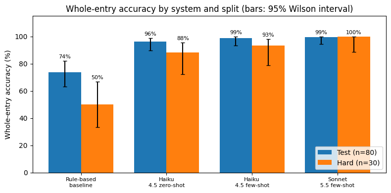
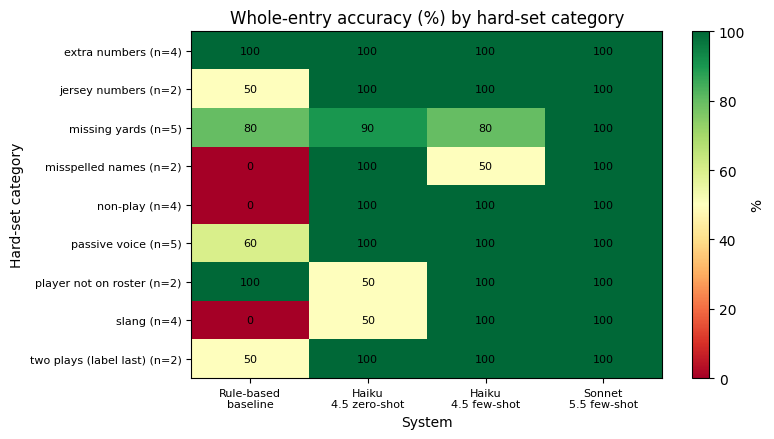

# Natural-Language Play Entry for a Flag Football Stat Tracker

Can an LLM turn a plain-English description of a flag football play into a structured stat record more accurately than a rule-based parser? And how much do few-shot examples and model size matter?

COMP 365 individual project (final evaluation).

```
"Marcus dumped it off to Jay, who took it 8 yards"
        ↓
{"play_type": "pass", "passer": "Marcus", "receiver": "Jaylen",
 "runner": null, "yards": 8, "result": "complete"}
```

## Results

All four systems were scored on the same 110 held-out sentences (80 standard test + 30 hard cases). Whole-entry accuracy means all six fields are correct. LLM systems were run twice; numbers are the mean over runs, with 95% Wilson intervals.

| System | Test (n=80) | Hard (n=30) | All (n=110) | Per-field |
|---|---|---|---|---|
| Rule-based baseline | 73.8% [63–82] | 50.0% [33–67] | 67.3% [58–75] | 91.8% |
| Claude Haiku 4.5, zero-shot | 96.2% [90–99] | 88.3% [72–96] | 94.1% [88–97] | 97.6% |
| Claude Haiku 4.5, few-shot | 98.8% [93–100] | 93.3% [79–98] | 97.3% [92–99] | 98.3% |
| Claude Sonnet 5.5, few-shot | 99.4% [94–100] | 100.0% [89–100] | 99.5% [96–100] | 99.6% |



Paired exact McNemar tests against the baseline (run 1, all 110 sentences):

| Comparison | Fixes | Breaks | p |
|---|---|---|---|
| Haiku zero-shot vs baseline | 32 | 3 | 4.2e-07 |
| Haiku few-shot vs baseline | 34 | 1 | 2.1e-09 |
| Sonnet few-shot vs baseline | 36 | 0 | 2.9e-11 |
| Haiku few-shot vs zero-shot | 6 | 2 | 0.29 |

Every LLM system beat the baseline by a clear margin. The gain from adding few-shot examples to Haiku was not statistically significant at this sample size.



## How it works

**Baseline.** Regex and keyword rules that classify the play, find roster names, aliases and jersey numbers, and pull out yardage. It was frozen before the evaluation data was written, so it does not know the `no_play` class.

**LLM parsers.** A system prompt with the roster, the output schema and labeling rules (negative yards for losses and offensive penalties, field position is not yards gained, and so on). The few-shot version adds the 20 dev examples. Replies are parsed as JSON and validated against the schema; a malformed reply counts as fully wrong.

## Data

[`data/play_dataset_v1.csv`](data/play_dataset_v1.csv) has 130 labeled sentences about a fictional six-player roster:

| Split | n | Use |
|---|---|---|
| dev | 20 | Few-shot prompt examples only |
| test | 80 | Standard held-out evaluation |
| hard | 30 | Passive voice, missing yards, extra numbers, misspellings, off-roster players, slang, jersey numbers, non-plays, two-play sentences |

The same data is embedded in the notebook, so it runs with no extra files.

**Note on labels:** sentences and primary labels were written with AI assistance (Claude) following a labeling guide, and a second check of 20 random rows was also done by Claude. There was no independent human annotation, so treat the gold labels as one consistent reading rather than ground truth.

## Running it

The easiest way is Google Colab: open `notebooks/final_eval.ipynb`, then Runtime > Run all.

Locally:

```bash
pip install -r requirements.txt
export ANTHROPIC_API_KEY=sk-ant-...   # optional; you'll be prompted if it isn't set
jupyter notebook notebooks/final_eval.ipynb
```

The baseline runs without a key. The LLM systems need an Anthropic API key, which is read from the environment or a hidden prompt and never saved. A full run makes about 660 API calls (110 sentences × 3 LLM systems × 2 runs) and takes about a minute.

Running the notebook writes `results.json`, `results_table.csv`, `predictions.json`, `errors.csv`, and the two figures to the working directory.

## Reproducibility

- Models: `claude-haiku-4-5-20251001` and `claude-sonnet-5-5`, default temperature, `max_tokens=1024`, two runs each.
- The original run used a Google Colab CPU runtime on 2026-10-19 with Python 3.13 and `anthropic` 1.15.0.
- LLM outputs vary between runs, so a rerun can differ by a sentence or two.

## Repository layout

```
├── notebooks/final_eval.ipynb   # full pipeline: data, baseline, prompts, scoring, results
├── data/play_dataset_v1.csv     # 130 labeled sentences
├── figures/                     # figures from the reported run
└── requirements.txt
```
